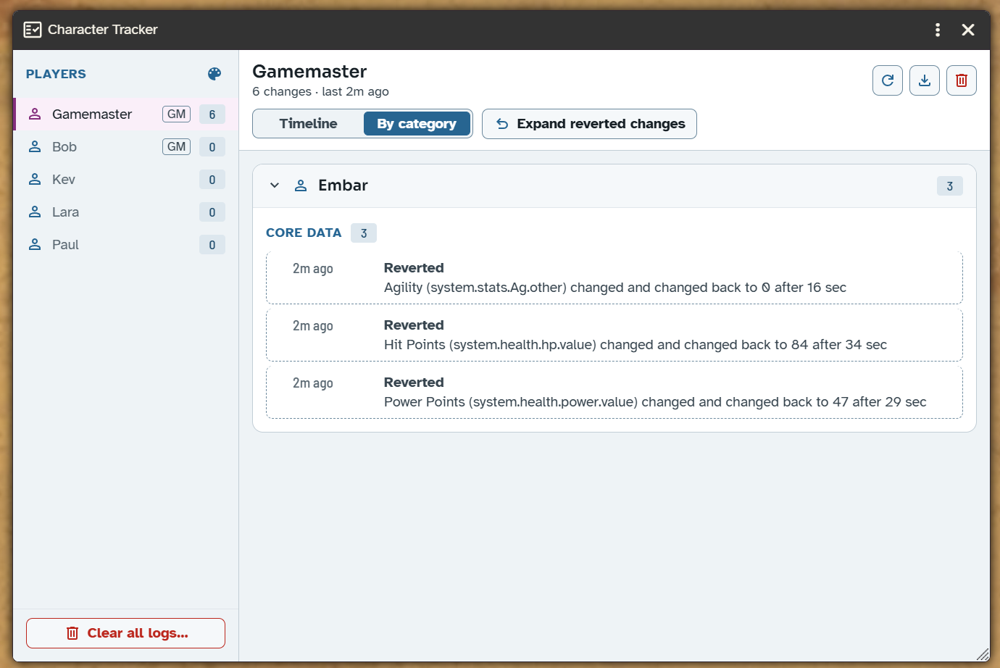

# Character Tracker

## Welcome to Character Tracker

This module provides a system-agnostic tracker for any changes made by players to characters (actors) they control. As a game option, the module can also track changes made by GMs to any player-owned actors.

This is a valuable tool for GMs to review character sheet modifications, such as during levelling up, particularly if you leave your game server accessible between live sessions. Changes are recorded even when no GM is logged in (see [Recording Changes When No GM Is Online](#recording-changes-when-no-gm-is-online)).

The module tracks:

- Modifications to core system data (e.g., stats, health, experience), showing both the previous and the new value (e.g., `Strength: 50 ➔ 55`).
- Adding, removing, or modifying embedded items and active effects.
- Changes players make while no GM is logged in, which are added to the log the next time a GM logs in.

## How to use the Character Tracker

1. **Open the Character Tracker window**: A new icon is available at the top of the `Actors` sidebar to open the interface.

   

2. **Navigation**:
   - The left panel displays a list of active players (and GMs, if tracking is enabled). Click a name to jump to their specific logs.
   - The right panel displays the audit log, nested by player and then by their individual characters. A high-level statistics summary is shown first, followed by a detailed chronological log that can be expanded or collapsed.
3. **Saving the Log**: You can export individual logs for each player by clicking the `Download` button next to their name.
4. **Switching the View**: You can switch between a chronological view (ideal for showing what was changing at the same time) and a categorical view (much easier to see what is being changed) by clicking the `Toggle View Mode` button at the bottom of the left panel. The categorical view groups changes by type (items, active effects and core data changes), and then further groups the changes by the specific item, effect or data being changed.
5. **Refresh the Tracker**: You can see new changes in the interface without closing the window by clicking the `Refresh` button at the bottom of the left panel.
6. **Clearing the Log**: You can wipe all logs globally (via the `Delete` button at the bottom of the left panel) or clear individual player logs (via the `Delete` button next to their name).
7. **Spotting Changes Made With No GM Online**: Entries that were recorded while no GM was logged in show a `No GM` badge beside the action. Hover over the badge for an explanation. The badge also appears in exported logs.

### Settings

| Setting | Default | What it does |
| :--- | :--- | :--- |
| `Track GM Changes` | Off | Also records changes GMs make to player-owned characters. |
| `Record Changes When No GM Is Online` | On | Records changes players make while no GM is logged in, and adds them to the log when a GM next logs in. |

### Recording Changes When No GM Is Online

Many groups leave their Foundry server running between sessions so players can level up or tidy their character sheets in their own time, often with no GM logged in. Foundry only runs modules in the browsers of users who are logged in, and only a GM can save to the Character Tracker log, so the module handles this in three steps:

1. **A player changes their character while no GM is online.** The player's own browser saves a record of each change on the character itself (in the character's data, where the player already has permission to write).
2. **The records wait on the character.** They stay there until a GM logs in. Nothing is lost if the player logs out, or if the server is restarted.
3. **A GM logs in.** The GM's browser collects the saved records from every character, adds them to the main log in the order the changes were made, and removes them from the characters.

If a GM is already logged in, changes are recorded straight into the log as normal, and nothing is saved on the character.

#### What to be aware of

- **Entries are marked.** Anything recorded this way shows a `No GM` badge in the log window and in exports, so you can tell it apart from changes recorded while you were online.
- **Players could, in principle, alter these entries.** Because the records sit on a character the player owns, a player with the technical know-how (for example, using a macro or the browser console) could edit or delete them before a GM logs in. Treat `No GM` entries as a helpful record rather than proof. As a safeguard, any entry that names a user who does not own that character is thrown away when it is collected.
- **Deleted characters lose their records.** If a character is deleted before a GM logs in, the changes saved on it are deleted with it.
- **Shared characters work.** If several players own the same character, each player's changes are saved separately and none overwrite another's.
- **Storage is capped.** Each character holds up to 500 waiting records. If more build up before a GM logs in, the oldest are removed first.

#### Turning it off

Recording with no GM online is controlled by the `Record Changes When No GM Is Online` world setting, which is on by default. If you turn it off, changes made while no GM is logged in are not recorded at all. Any records already saved on characters are still collected the next time a GM logs in, so turning the setting off never loses changes that were already saved.

### System-Specific Dictionaries and Localisation

Whilst the module works with any system, system-specific dictionaries can be added to convert standard dot-notation database keys (e.g., `system.health.hp.value`) into more easily readable text (e.g., `Hit Points`). If the game system provides its own localisation files, the tracker maps to these keys, making sure it can translate into any language supported by the system.

For the initial release, a simple dictionary has been included for the Rolemaster Unified (RMU) system as an example.

## Roadmap

These features are planned for future updates, in no particular order:

- Add dictionaries for other popular systems.
- Extract deeper, system-specific details from items and active effects.
